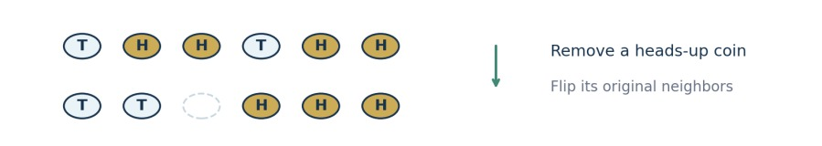

# Task [1]: Coin Removal

## 1. Task Information

A line of coins lies on a table, each showing either heads or tails. A move removes any heads-up coin and then flips its immediate neighbors, if present. Two coins count as neighbors only if they were adjacent in the original line; removing a coin does not close the gap. Determine precisely which starting rows can be cleared and give a valid removal sequence.



- **Required Function Signature:**
  removeCoins(n: int, coins: char[]) -> (possible: bool, flips: int[])
- **Required Algorithmic Technique:** Greedy

## 2. Problem Description

You are given a line of coins. Each coin has one of two possible states:
- **H (Heads):** The front side of the coin.
- **T (Tails):** The back side of the coin.
  
You are allowed to perform the following operation, called a **Move**:
1. Select any coin that is currently showing Heads.
2. Remove that coin from the line.
3. Flip its immediate neighbors, if they exist.
4. Repeat until all coins are removed or no valid move is possible.
   
**Important:** Neighbors are determined by their positions in the original line. Removing a coin does not make previously non-adjacent coins become neighbors.

### Required function:
- removeCoins(n, coins) -> (possible, flips)

## 3. Assumptions

[List any assumptions made while interpreting or solving the problem. If no additional assumptions are needed, write "No additional assumptions."]

1. [Assumption 1]
2. [Assumption 2]
3. [Assumption 3]

## 4. Algorithm Explanation

### Core Idea

[Explain the main idea behind the solution.]

### Why This Technique?

[Explain how the assigned algorithmic technique is applied and why the solution follows this technique.]

### Solution Approach

[Describe how the algorithm solves the problem, including the important decisions and cases it handles.]

## 5. Test Cases

At least **three test cases** must be provided to demonstrate the correctness of the solution.

### Test Case 1: [Test Case Name]

- **Purpose:** [What does this test case verify?]
- **Input:**
  ```text
  [Input]
  ```
- **Expected Output:**
  ```text
  [Expected Output]
  ```
- **Actual Output:**
  ```text
  [Actual Output]
  ```
- **Result:** [PASS / FAIL]
- **Screenshot:** [Add screenshot path or link]

### Test Case 2: [Test Case Name]

- **Purpose:** [What does this test case verify?]
- **Input:**
  ```text
  [Input]
  ```
- **Expected Output:**
  ```text
  [Expected Output]
  ```
- **Actual Output:**
  ```text
  [Actual Output]
  ```
- **Result:** [PASS / FAIL]
- **Screenshot:** [Add screenshot path or link]

### Test Case 3: [Test Case Name]

- **Purpose:** [What does this test case verify?]
- **Input:**
  ```text
  [Input]
  ```
- **Expected Output:**
  ```text
  [Expected Output]
  ```
- **Actual Output:**
  ```text
  [Actual Output]
  ```
- **Result:** [PASS / FAIL]
- **Screenshot:** [Add screenshot path or link]

## 7. Complexity Analysis

### Time Complexity

- **Complexity:** (O(...))
- **Analysis:** [Explain how the time complexity is derived. Identify the main operations and how their execution depends on the input size.]

### Space Complexity

- **Complexity:** (O(...))
- **Analysis:** [Explain the additional memory required by the algorithm and how it depends on the input size.]
